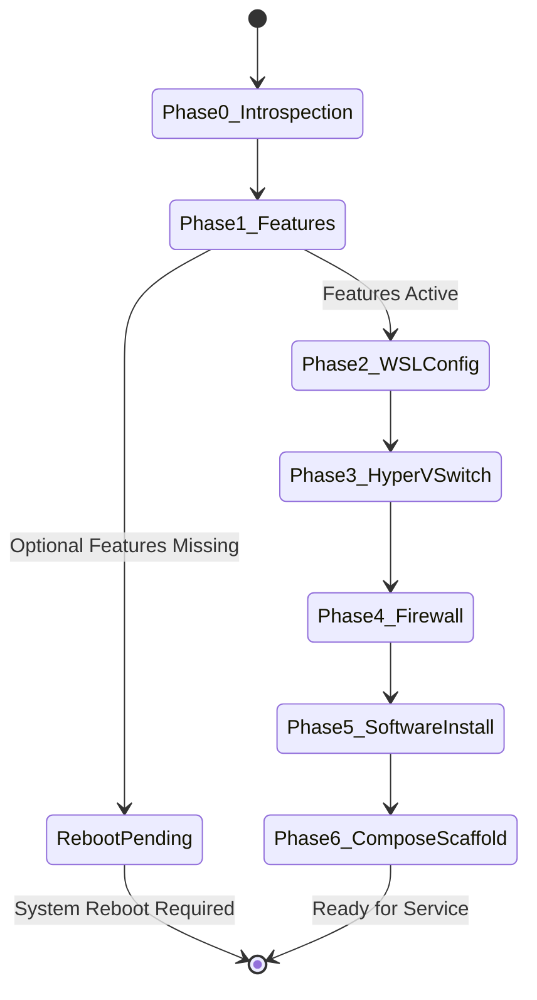

# Technical Design Document: Automated Workstation Provisioner

## 1. Execution Flow & State Machine



## 2. Component Specifications

### 2.1 Hardware Introspection
- Checks `Win32_ComputerSystem.Model` to detect virtualized environments.
- Queries `Win32_VideoController` for NVIDIA hardware.
- If GPU is absent or `-ForceCPU` is specified, generates CPU-compatible container manifests.

### 2.2 WSL2 Mirrored Networking
- Generates `$env:USERPROFILE\.wslconfig`:
  ```ini
  [wsl2]
  networkingMode=mirrored
  autoProxy=true
  dnsTunneling=true

  [experimental]
  autoMemoryReclaim=gradual
  sparseVhd=true
  ```

### 2.3 Hyper-V Bridged External Switch
- Queries physical network adapters where `Status = 'Up'`.
- Filters out virtual interfaces and Hyper-V loopbacks.
- Creates external switch via `New-VMSwitch -Name "Bridged-External-Switch" -NetAdapterName $adapter.Name -AllowManagementOS $true`.

### 2.4 Firewall Automation
- Configures inbound TCP rules for `11434` (Ollama), `3000` (Open WebUI), `8188` (ComfyUI), and `47984, 47990` (Sunshine).
- Configures inbound UDP rules for `47998, 47999, 48000, 48010` (Sunshine audio/video/control/QoS).
